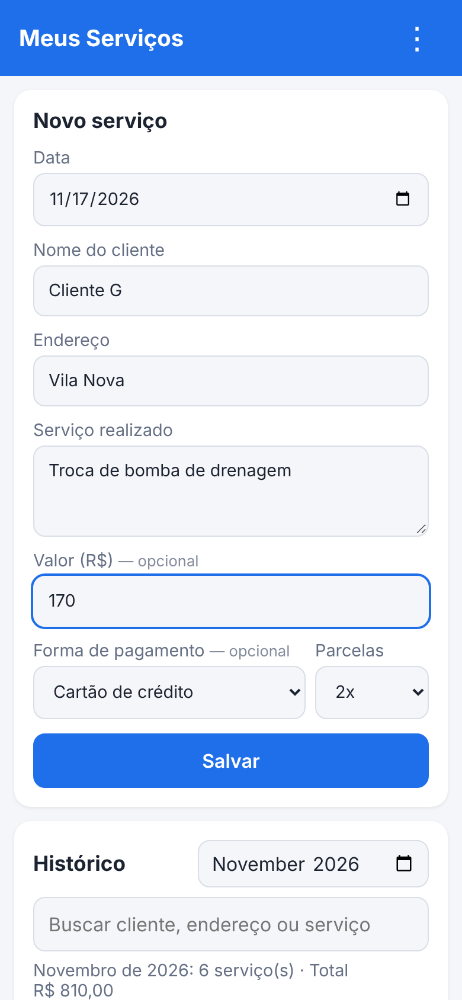
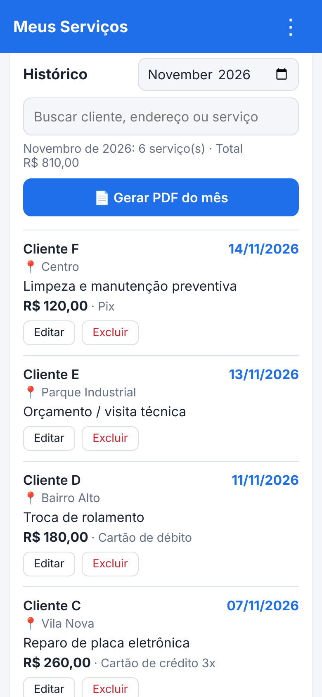
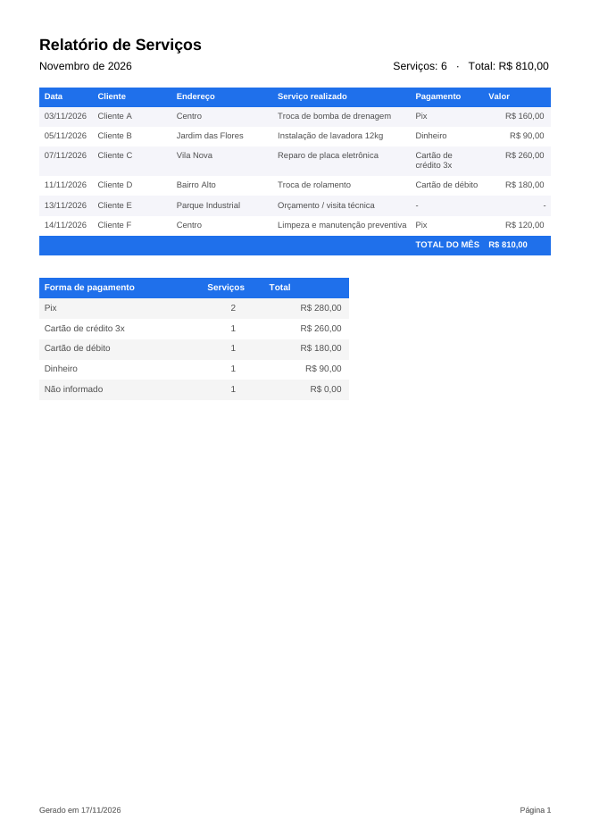

# Meus Serviços

App simples para quem presta serviços (técnicos, autônomos, prestadores em geral) **anotar os
serviços feitos no dia a dia** e gerar um **relatório mensal em PDF**.

- Funciona **100% offline**: sem internet, sem cadastro, sem login.
- Os dados ficam **somente no seu celular**. Nada é enviado para servidores.
- Gratuito e de código aberto.

<p align="center">
  
  &nbsp;
  
  &nbsp;
  
</p>

## ⬇️ Baixar (Android)

**[Baixar MeusServicos.apk](https://github.com/oliveiraronaldo/AppServicos/releases/latest/download/MeusServicos.apk)**
· [todas as versões](https://github.com/oliveiraronaldo/AppServicos/releases)

### Como instalar
1. Abra o link acima **no celular** e baixe o arquivo `MeusServicos.apk`.
2. Abra o arquivo baixado (pela notificação do download ou pelo app *Arquivos*).
3. Como o app não vem da Play Store, o Android pode pedir permissão:
   toque em **Configurações → Permitir desta fonte**, volte e toque em **Instalar**.
4. Pronto! O app **Meus Serviços** aparece na lista de aplicativos.

**Para atualizar:** baixe o APK mais novo pelo mesmo link e instale por cima. Seus dados são mantidos.

> **iPhone ou computador:** use a versão web em
> https://oliveiraronaldo.github.io/AppServicos/ e, no Safari, toque em
> *Compartilhar → Adicionar à Tela de Início*. Depois de aberta uma vez, ela também funciona offline.

## Como usar

### Registrar um serviço
Preencha os campos e toque em **Salvar**:

| Campo | Observação |
|---|---|
| Data | Já vem com a data de hoje; pode ser alterada |
| Nome do cliente | Sugere nomes já usados |
| Endereço | Ao escolher um cliente já cadastrado, sugere o último endereço dele |
| Serviço realizado | Descrição livre |
| Valor (R$) | Opcional. Aceita `150`, `150,50` ou `1.250,00` |
| Forma de pagamento | Opcional. Pix, Dinheiro, Cartão de crédito (1x a 12x) ou Cartão de débito |

### Histórico
- Escolha o **mês** no topo do histórico para ver os serviços e o **total do mês**.
- Use a **busca** para encontrar por cliente, endereço ou serviço.
- **Editar** e **Excluir** ficam em cada serviço.

### Relatório em PDF
Toque em **Gerar PDF do mês**. O relatório traz todos os serviços do mês selecionado, o total e um
resumo por forma de pagamento. O celular abre o menu de compartilhar: salve em *Arquivos*/*Drive* ou
envie por WhatsApp/e-mail.

### Backup (importante!)
Como os dados ficam só no aparelho, **desinstalar o app ou limpar os dados dele apaga os registros**.
Faça backup com frequência:

- **⋮ → Exportar backup**: gera um arquivo `.json` com todos os serviços. Guarde-o no Drive, e-mail etc.
- **⋮ → Importar backup**: restaura um arquivo de backup (serviços já existentes não são duplicados).

O backup também serve para **trocar de celular** ou passar os dados da versão web para o app.

---

## Para desenvolvedores

### Estrutura

```
www/                     o app (HTML/CSS/JS puro, sem build)
  index.html, app.js, styles.css
  sw.js, manifest.webmanifest   PWA / funcionamento offline
  icons/                 ícones da versão web
  vendor/                jsPDF + jsPDF-AutoTable (MIT), geram o PDF localmente
resources/android/       ícones do app Android e chave de assinatura do APK
capacitor.config.json    configuração do Capacitor (empacota www/ como app Android)
.github/workflows/       gera o APK e publica em Releases a cada alteração
docs/                    imagens deste README
index.html               redireciona o GitHub Pages para www/
```

### Rodar localmente
Qualquer servidor estático serve, por exemplo:

```bash
python3 -m http.server 8000
# abra http://localhost:8000/www/
```

### Gerar o APK
O APK é gerado automaticamente pelo GitHub Actions ([`android.yml`](.github/workflows/android.yml))
a cada push que altera `www/`, `resources/` ou a configuração, e publicado em
[Releases](https://github.com/oliveiraronaldo/AppServicos/releases). Também pode ser disparado
manualmente em *Actions → Gerar APK Android → Run workflow*.

Para gerar na sua máquina (requer Node 20, JDK 17 e Android SDK):

```bash
npm install
npx cap add android
cp -r resources/android/res/* android/app/src/main/res/
cd android && ./gradlew assembleDebug
```

### Formato do backup

```json
{
  "app": "meus-servicos",
  "versao": 1,
  "servicos": [
    {
      "id": "abc123",
      "data": "2026-11-04",
      "cliente": "Nome",
      "endereco": "Bairro / endereço",
      "servico": "Descrição",
      "valor": 17000,
      "pagamento": "pix",
      "parcelas": null
    }
  ]
}
```

- `valor` em **centavos** (inteiro) ou `null`.
- `pagamento`: `""`, `"pix"`, `"dinheiro"`, `"credito"` ou `"debito"`; `parcelas` (1–12) só para `"credito"`.

### Observações
- Ao alterar arquivos em `www/`, aumente a versão de `CACHE` em `www/sw.js` para a versão web se atualizar.
- A chave de assinatura (`resources/android/meusservicos.keystore`) está no repositório para simplificar
  o build. Ela precisa ser sempre a mesma, ou as atualizações do APK não instalam por cima.
